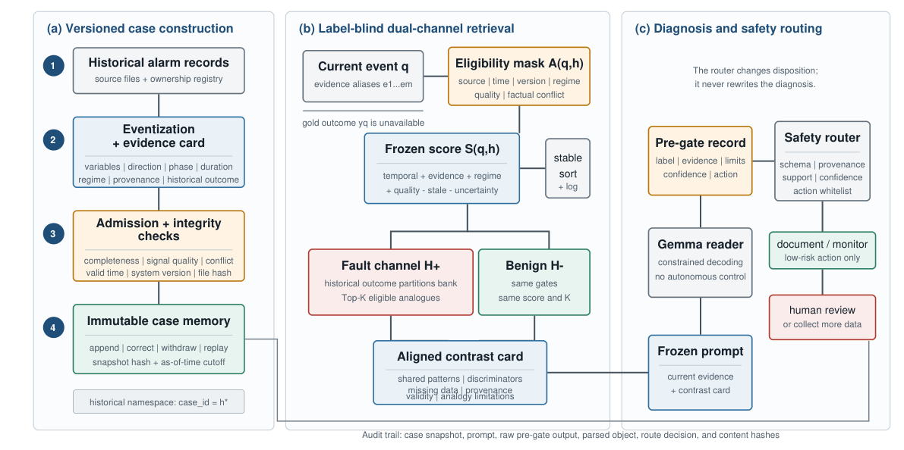
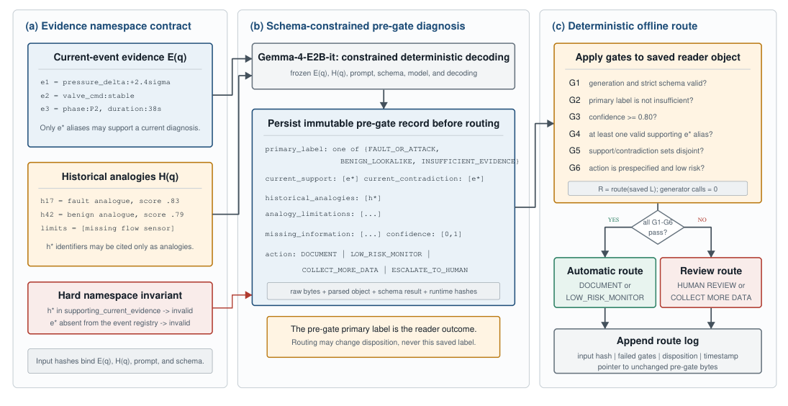
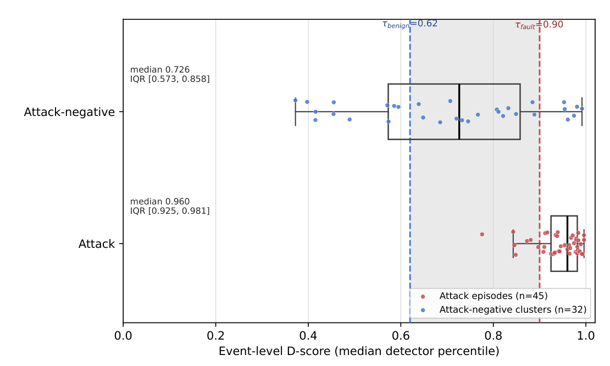

**English** | [简体中文](README_zh.md)

# Auditable Alarm Diagnosis

## Evidence-Role Separation and Risk-Bounded Selective Calibration for Industrial Fault Disposition

This directory introduces the manuscript:

> **Auditable Alarm Diagnosis: Evidence-Role Separation and Risk-Bounded Selective Calibration for Industrial Fault Disposition**<br>
> Wu Zhang, Tianwu Lei, Luo Xiao, and Yong Yang<br>
> Submitted to *Sensors*, manuscript version dated August 4, 2026

The paper asks how an industrial alarm workflow can combine current sensor evidence,
historical cases, a language-model explanation, and an operational disposition without
allowing those objects to silently replace one another.

The proposed answer has two parts:

1. an executable **evidence-role contract** that keeps current evidence, historical
   analogies, language output, and the final route separate and auditable; and
2. **audit-constrained selective calibration (ACSC)**, which maximizes automatic coverage
   only among routing policies that satisfy prespecified bounds on dangerous and nuisance
   errors.

The resulting system is decision support, not autonomous plant control. It may issue
`FAULT`, `BENIGN`, or `ABSTAIN`, but high-risk action and unresolved evidence remain
subject to human review.

## Manuscript Files

- [Main manuscript (PDF)](manuscript/AuditableAlarmDiagnosis0805.pdf)
- [Supplementary material (PDF)](manuscript/AuditableAlarmDiagnosis_supplementary0805.pdf)

## Core Idea: Four Non-Interchangeable Objects

For a query event `q`, the protocol separates:

| Object | Meaning | Allowed role |
| --- | --- | --- |
| `E(q)` | Current-event detector evidence | Supports claims about the event being assessed |
| `H(q)` | Versioned historical analogues | Provides comparison and context, never present-event fact |
| `L(q; E, H)` | Immutable language-model record | Interprets the frozen evidence and analogues |
| `R(q; E, L)` | Separately logged disposition | Routes the event to `FAULT`, `BENIGN`, or `ABSTAIN` |

Query truth is excluded from calibration, retrieval, ranking, fusion, and reader input.
Historical outcomes remain in an analogy namespace, and the router cannot rewrite the
saved language-model record.



*Figure 1. Versioned case construction, label-blind dual-channel retrieval, and separately
audited diagnosis and safety routing.*

## Audit Invariants

The method defines four machine-checkable invariants:

1. **Source-role non-interference** - training, historical-case, development, evaluation,
   and confirmation partitions have explicit, non-overlapping responsibilities.
2. **Historical non-assertion** - historical outcomes may be cited as analogies but cannot
   become supporting evidence for the current event.
3. **Immutable explanation and non-overwriting routing** - raw reader input, output,
   parsed objects, and hashes are retained; offline routing creates a new record without
   another generator call.
4. **Claim admissibility** - integrity, detector, retrieval, routing, and confirmation
   claims are released only after their corresponding gates pass.



*Figure 2. Current-event aliases and historical-case identifiers occupy different
namespaces. A deterministic router applies six gates to the saved pre-gate record and
appends a disposition without changing the original diagnosis.*

## End-to-End Workflow

```text
freeze source-role ledger and denominators
  -> calibrate detector references from training-normal data
  -> build current-event evidence E(q)
  -> retrieve eligible fault and benign analogues H(q)
  -> construct a contrast card
  -> save immutable reader record L(q; E, H)
  -> apply ACSC / safety routing as a separate R(q; E, L)
  -> evaluate integrity, detector, retrieval, routing, and confirmation gates
  -> release only gate-authorized claims
```

The retrieval layer uses the same frozen eligibility rules, scoring function, and `K` for
fault and benign channels. The aligned contrast card records shared patterns,
discriminators, missing information, provenance validity, and analogy limitations.

## Evaluation Design

| Benchmark or assay | Independent unit | Purpose |
| --- | --- | --- |
| HAI 21.03 complete queue | 49 events: 45 attack episodes and 4 attack-negative clusters | Retrospective detector ranking and retrieval evaluation |
| HAI expanded frame | 77 events: 45 attacks and 32 attack-negative clusters | In-frame calibration of an abstaining disposition |
| HAI reader cohort | 32 events | Controlled reader-context diagnostics |
| Blinded expert subset | 160 query-case pairs | Human validation of retrieval relevance |
| TEP development frame | 500 runs per partition | Router selection, stability checks, and comparator evaluation |
| TEP sealed confirmation | 400 fault and 100 normal runs | One-shot held-out evaluation of one frozen ACSC candidate |

The study uses exact count intervals, query-level paired bootstrap intervals for retrieval,
and one-sided 97.5% Clopper-Pearson upper bounds for the two routing risks.

## Main Results

| Result | Reported value | Interpretation boundary |
| --- | ---: | --- |
| HAI continuous D-score, original 49-event queue | AUROC 0.811 | Retrospective ranking result |
| HAI continuous D-score, expanded 77-event frame | AUROC 0.902 | In-sample expanded-frame result |
| Expanded-frame negative specificity | 22/32 | Supports calibrated abstention, not unrestricted benign automation |
| Structured QAKB retrieval | nDCG@5 0.9565 | Numerically highest; not statistically distinguished from full hybrid RRF |
| Expert-expert agreement | weighted kappa 0.684 | Prespecified substantial-agreement target passed |
| Model-expert agreement | weighted kappa 0.547 | Moderate positive agreement |
| Expert-graded structured retrieval | nDCG@5 0.918 | Human-grounded validation of the structured channel |
| ACSC on TEP development selection frame | coverage 432/500 | Highest coverage among methods passing both risk bounds |
| ACSC sealed TEP confirmation | coverage 430/500 (0.860) | One-shot held-out result |
| Sealed fault-to-benign risk | 9/400; upper bound 0.042 | Passes the prespecified 0.05 limit |
| Sealed normal-to-fault risk | 4/100; upper bound 0.099 | Passes the 0.10 limit by a narrow margin |



*Figure 3. Expanded HAI event-level D-score distribution. The frozen thresholds
`τ_benign = 0.62` and `τ_fault = 0.90` leave an explicit abstention region for residual
overlap.*

The numerical router is essential: on the exposed TEP stability cohort, the original
complete-interface reader recognized only 5 of 400 fault runs, whereas the training-fitted
numerical router recognized 330 of 400. ACSC then converts numerical recovery into a
selective operating point whose two error bounds are checked jointly.

## What the Results Do and Do Not Establish

The passed gates support:

- machine-auditable evidence provenance and role separation;
- a calibrated, abstaining HAI disposition on the expanded frame;
- expert-validated structured dual-channel retrieval;
- safe selective routing within the prespecified TEP risk limits; and
- one held-out confirmation of the frozen ACSC candidate.

They do **not** establish:

- causal root-cause localization;
- prospective performance in an operating plant;
- autonomous control safety;
- unrestricted benign automation; or
- a distribution-free guarantee outside the evaluated populations.

The normal-to-fault confirmation margin is especially sensitive: one additional error in
the 100-run normal sample would have exceeded the prespecified bound. Prospective
negative-event collection, operator human-factors evaluation, plant shadow-mode testing,
and causal localization remain future work.

## Reproducibility Scope

The manuscript and supplement document the frozen protocol, denominators, statistical
units, claim gates, and reported aggregate results. Raw HAI/TEP benchmark data and model
weights are not redistributed. Exact reconstruction additionally requires the released
source-role manifests, case versions, hashes, prompts, reader/router records, assay grades,
and frozen aggregate artifacts referenced by the manuscript.

## Executable Reference Implementation

The dependency-free Python implementation is in [`src/`](src/). It now includes a
complete raw-series orchestration path: pluggable ModernTCN, TimesNet, and TranAD
adapters, normal-reference calibration, label-blind retrieval, an OpenAI-compatible
or offline auditable reader, immutable records, six safety gates, ACSC/reader agreement
routing, claim authorization, a full synthetic example, and unit tests. Bundled
statistical detector proxies are explicitly marked for demonstration only and are not
neural-model reproductions. See [`src/README.md`](src/README.md) for commands, real
model integration, LLM configuration, and scope boundaries.

The DOI printed by the journal template is a placeholder and should not be cited as a
persistent identifier.

## Citation

```bibtex
@unpublished{zhang2026auditable_alarm,
  title  = {Auditable Alarm Diagnosis: Evidence-Role Separation and
            Risk-Bounded Selective Calibration for Industrial Fault Disposition},
  author = {Zhang, Wu and Lei, Tianwu and Xiao, Luo and Yang, Yong},
  note   = {Manuscript submitted to Sensors},
  year   = {2026}
}
```
