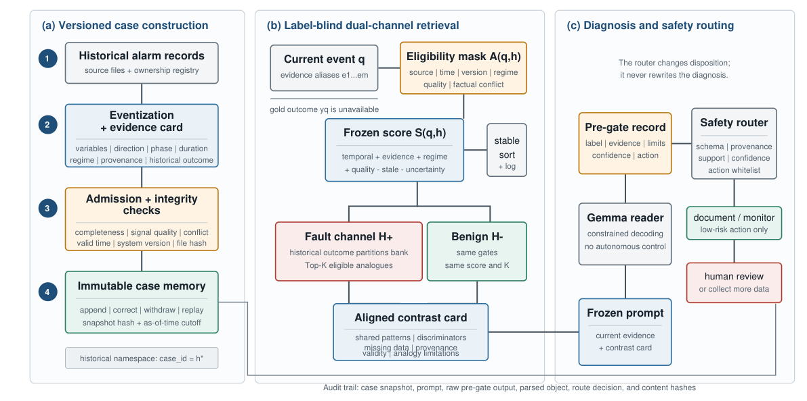
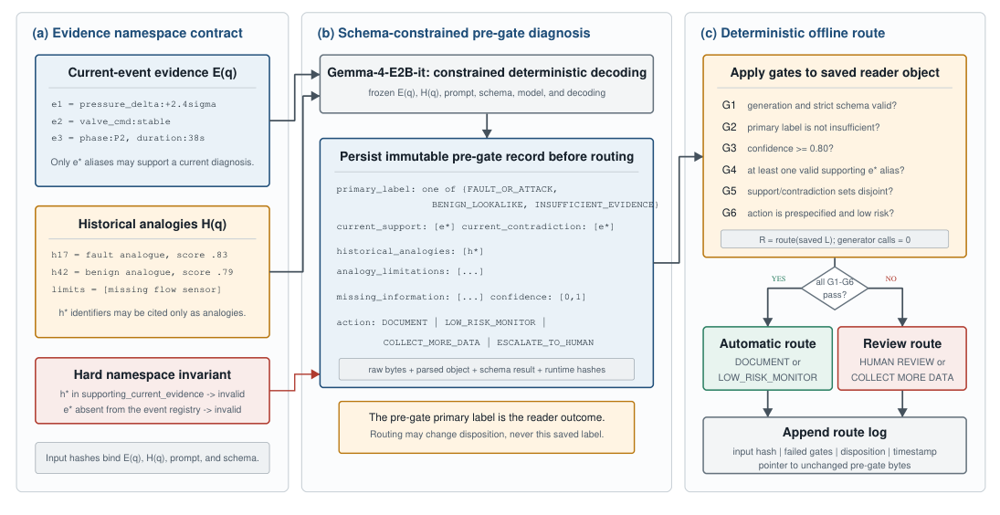
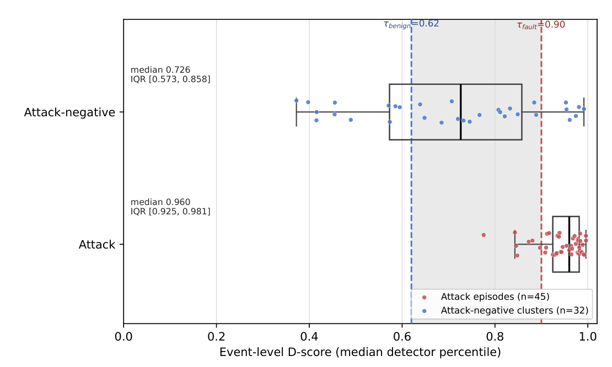

[English](README.md) | **简体中文**

# 可审计报警诊断

## 面向工业故障处置的证据角色隔离与风险有界选择性校准

本目录介绍以下论文：

> **Auditable Alarm Diagnosis: Evidence-Role Separation and Risk-Bounded Selective Calibration for Industrial Fault Disposition**<br>
> Wu Zhang、Tianwu Lei、Luo Xiao、Yong Yang<br>
> 投稿至 *Sensors*，论文版本日期为 2026 年 8 月 4 日

论文研究的问题是：工业报警流程如何同时使用当前传感器证据、历史案例、语言模型解释和最终处置，
又不让这些对象在流程中被悄然混用或相互替代。

论文提出两项核心方法：

1. 可执行的**证据角色契约**，将当前证据、历史类比、语言输出和最终路由保持为相互独立、可审计的对象；
2. **审计约束选择性校准（ACSC）**，仅在同时满足危险错误与干扰错误预设上界的候选策略中最大化自动覆盖率。

该系统定位为决策支持，而不是自主工业控制。系统可以给出 `FAULT`、`BENIGN` 或 `ABSTAIN`，
但高风险动作和证据不足的事件必须保留人工复核路径。

## 论文文件

- [论文正文（PDF）](manuscript/AuditableAlarmDiagnosis0805.pdf)
- [补充材料（PDF）](manuscript/AuditableAlarmDiagnosis_supplementary0805.pdf)

## 核心思想：四类不可互换的对象

对于待诊断事件 `q`，协议明确分离：

| 对象 | 含义 | 允许承担的角色 |
| --- | --- | --- |
| `E(q)` | 当前事件的检测器证据 | 支持对当前待评估事件的判断 |
| `H(q)` | 带版本的历史类比案例 | 提供比较和背景，不能作为当前事件事实 |
| `L(q; E, H)` | 不可变的语言模型记录 | 解释冻结后的当前证据和历史类比 |
| `R(q; E, L)` | 单独记录的处置结果 | 将事件路由为 `FAULT`、`BENIGN` 或 `ABSTAIN` |

查询事件真值不得进入校准、检索、排序、融合或读者输入。历史结果只能存在于类比命名空间中，
安全路由器也不能重写已经保存的语言模型记录。



*图 1：带版本的案例构建、标签盲双通道检索，以及相互独立审计的诊断与安全路由。*

## 四项审计不变量

方法定义了四项可由机器检查的不变量：

1. **来源-角色不干扰**：训练、历史案例、开发、评估和确认分区具有明确且互不混淆的职责。
2. **历史非断言**：历史结果可以作为类比引用，但不能成为支持当前事件结论的证据。
3. **解释不可变、路由不覆盖**：保留原始读者输入、输出字节、解析对象和哈希；离线路由无需再次调用生成器，只新增处置记录。
4. **声明准入**：完整性、检测器、检索、路由和确认结论只有在对应门控通过后才能发布。



*图 2：当前事件证据别名与历史案例标识符使用不同命名空间。确定性路由器对已保存的门控前记录执行六项检查，追加处置结果而不修改原始诊断。*

## 端到端流程

```text
冻结来源-角色账本和统计分母
  -> 使用训练正常数据校准检测器参考分布
  -> 构建当前事件证据 E(q)
  -> 分别检索合格的故障与良性历史类比 H(q)
  -> 构建对齐对比卡
  -> 保存不可变读者记录 L(q; E, H)
  -> 以独立记录执行 ACSC / 安全路由 R(q; E, L)
  -> 检查完整性、检测器、检索、路由和确认门控
  -> 只发布已获门控授权的结论
```

故障与良性检索通道使用相同的冻结资格规则、评分函数和 `K` 值。对齐对比卡记录共同模式、
区分特征、缺失信息、来源有效性和类比局限。

## 实验设计

| 基准或评估 | 独立统计单元 | 论文中的用途 |
| --- | --- | --- |
| HAI 21.03 完整队列 | 49 个事件：45 个攻击片段、4 个攻击阴性报警簇 | 检测器回顾性排序与检索评估 |
| HAI 扩展框架 | 77 个事件：45 个攻击、32 个攻击阴性报警簇 | 对带拒判处置进行框架内校准 |
| HAI 读者队列 | 32 个事件 | 受控的读者上下文诊断 |
| 盲法专家子集 | 160 个查询-案例对 | 检索相关性的人类验证 |
| TEP 开发框架 | 每个分区 500 次运行 | 路由器选择、稳定性检查和比较实验 |
| TEP 封存确认集 | 400 次故障运行、100 次正常运行 | 对单个冻结 ACSC 候选进行一次性留出评估 |

研究对计数比例使用精确区间，对检索差异使用查询级配对 Bootstrap 区间，
对两类路由风险使用单侧 97.5% Clopper-Pearson 上界。

## 主要结果

| 结果 | 论文报告值 | 解释边界 |
| --- | ---: | --- |
| 原始 49 事件队列的 HAI 连续 D 分数 | AUROC 0.811 | 回顾性排序结果 |
| 扩展 77 事件框架的 HAI 连续 D 分数 | AUROC 0.902 | 扩展框架内结果 |
| 扩展框架攻击阴性特异度 | 22/32 | 支持带拒判校准，不支持无限制良性自动化 |
| 结构化 QAKB 检索 | nDCG@5 0.9565 | 数值最高，但与完整混合 RRF 无统计显著差异 |
| 专家-专家一致性 | 加权 kappa 0.684 | 通过预设的实质一致性门槛 |
| 模型-专家一致性 | 加权 kappa 0.547 | 中等程度正一致 |
| 专家评分的结构化检索 | nDCG@5 0.918 | 为结构化通道提供人类相关性验证 |
| TEP 开发选择框架上的 ACSC | 覆盖率 432/500 | 在同时通过两类风险界限的方法中覆盖率最高 |
| TEP 封存确认集上的 ACSC | 覆盖率 430/500（0.860） | 一次性留出确认结果 |
| 封存确认中的故障转良性风险 | 9/400；上界 0.042 | 通过预设 0.05 限值 |
| 封存确认中的正常转故障风险 | 4/100；上界 0.099 | 以较小余量通过 0.10 限值 |



*图 3：扩展 HAI 框架上的事件级 D 分数分布。冻结阈值 `τ_benign = 0.62` 与
`τ_fault = 0.90` 之间保留显式拒判区域，以处理两类事件的剩余重叠。*

数值路由器在系统中至关重要：在公开的 TEP 稳定性队列上，原始完整接口读者仅识别出
400 个故障运行中的 5 个，而训练拟合的数值路由器识别出 330 个。ACSC 进一步将这种数值恢复能力
转化为选择性工作点，并同时检查两类错误上界。

## 结论边界

通过的门控支持以下结论：

- 证据来源及角色可由机器审计；
- HAI 扩展框架上的带拒判校准处置；
- 经专家验证的结构化双通道检索；
- 在预设 TEP 风险界限内的安全选择性路由；
- 对冻结 ACSC 候选的一次留出确认。

这些结果**不能**证明：

- 因果根因定位；
- 真实运行工厂中的前瞻性能；
- 自主控制安全性；
- 不受限制的良性自动处置；
- 评估总体之外的分布无关保证。

正常转故障风险的确认余量尤其有限：100 次正常运行中若再多 1 个错误，就会超过预设上界。
未来仍需开展前瞻性阴性事件采集、操作员人因评估、工厂影子模式测试和因果定位研究。

## 可复现性范围

论文正文与补充材料记录了冻结协议、统计分母、独立统计单元、声明门控和聚合结果。
项目不重新分发 HAI/TEP 原始数据和模型权重。完整重建还需要论文中引用的来源-角色清单、
案例版本、哈希、提示词、读者/路由记录、评估等级和冻结聚合产物。

## 可执行参考实现

无第三方依赖的 Python 参考实现位于 [`src/`](src/)，现已包含从原始多变量时序到最终处置的
完整编排：三路异常检测器适配、训练正常参考校准、标签盲双通道检索、可替换的 LLM 读者、
不可变读者与路由记录、六项安全门控、ACSC 数值策略合议、声明准入、完整合成示例和单元测试。
运行命令、OpenAI-compatible LLM 配置以及真实 ModernTCN、TimesNet、TranAD 推理函数的接入方式
见 [`src/README.md`](src/README.md)。

仓库自带的 `reference-proxy-v1` 三路检测器仅用于无权重情况下的端到端演示和集成测试，
不是三个神经网络架构的复现，也不能作为论文模型结果报告；生产使用时必须通过适配器接入
真实模型推理或按事件导出的真实分数。

期刊模板中显示的 DOI 是占位符，不应作为永久标识符引用。

## 引用

```bibtex
@unpublished{zhang2026auditable_alarm,
  title  = {Auditable Alarm Diagnosis: Evidence-Role Separation and
            Risk-Bounded Selective Calibration for Industrial Fault Disposition},
  author = {Zhang, Wu and Lei, Tianwu and Xiao, Luo and Yang, Yong},
  note   = {Manuscript submitted to Sensors},
  year   = {2026}
}
```
